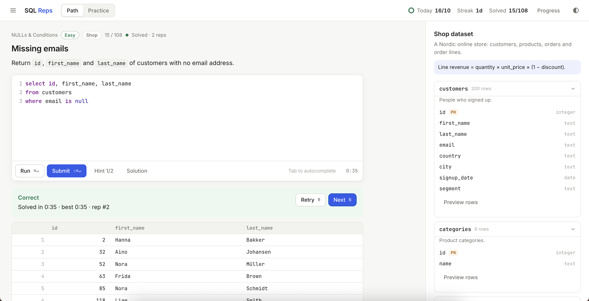

# SQL Reps

**Volume training for SQL — from simple SELECTs to window functions and real business cases.**

### ▶ [Open the app](https://Isakstevik.github.io/sql-reps/)

Runs entirely in your browser. No sign-up, no install, no backend.

<!-- Add a screenshot: upload screenshot.png to the repo and uncomment the line below -->
 

---

## Why I built this

I study business analytics, and SQL is one of the skills I most want to keep sharp. While preparing for a technical interview, I looked for a place to practise SQL hands-on. I couldn't find one that was simple, focused and active. Most options were video courses, long tutorials, or platforms buried under sign-ups and paywalls. I wanted to open a page, get an exercise, write a query and find out right away whether I got it right and why.

So I built it. SQL Reps is the tool I'll come back to whenever I need to refresh my skills before an interview. It's also the program I wish I'd had when I first learned SQL: one exercise at a time, real data, honest feedback, and enough repetition for the patterns to stick.

> **Disclaimer:** This project was built with [Claude Code](https://claude.com/claude-code), Anthropic's AI coding assistant. I defined the idea, requirements and design, and guided and tested the result. Claude Code wrote the code, the datasets and the exercises.

## What it is

SQL Reps gives you one exercise at a time with the table schema beside it. Write a query and submit it. A wrong answer shows exactly what differs from the expected result. A right answer lets you retry the exercise with new values or move on to the next one.

It runs a real **PostgreSQL** database in the browser (via [PGlite](https://pglite.dev)), so everything you practise works the same way at work.

## Features

- **108 exercises** across 13 topics and 3 difficulty levels
- **4 realistic datasets**: an online shop, an HR org chart, a SaaS subscription business and a retail store chain
- **Two modes**
  - *Path*: work through the curriculum in order
  - *Practice*: filter by topic, level or status, and get a weighted mix of exercises you haven't solved or got wrong
- **Smart checking**: compares result sets, so any correct query passes, whatever its aliases or column order
- **Useful feedback**: wrong row counts, mismatched columns, duplicate rows from bad joins, rounding and integer-division hints, plus your result and the expected result side by side
- **Hints and solutions** that unlock one at a time
- **Built for reps**: variants with new values on retry, keyboard shortcuts, a timer and personal best, a daily goal, a streak and a progress overview

## Topics

| | | |
|---|---|---|
| Select & Filter | Sorting & Limiting | NULLs & Conditions |
| Aggregation | Joins | CASE Logic |
| Dates & Time | Text & Number Functions | Subqueries |
| Set Operations | CTEs & Recursion | Window Functions |
| Business Cases (MRR, churn, cohorts, YoY, Pareto) | | |

## Keyboard shortcuts

| Action | Mac | Windows |
|---|---|---|
| Run query | `⌘ Enter` | `Ctrl Enter` |
| Submit answer | `⇧ ⌘ Enter` | `Ctrl Shift Enter` |
| Next exercise (after a correct answer) | `N` | `N` |
| Retry with new values | `R` | `R` |
| Exercise list | `L` | `L` |
| Autocomplete | `Tab` | `Tab` |

## Tech

Plain HTML, CSS and JavaScript with no build step.
- [PGlite](https://pglite.dev): PostgreSQL compiled to WebAssembly
- [CodeMirror 5](https://codemirror.net/5/): the SQL editor
- Datasets are generated from a fixed seed, so every visitor gets the same data
- Progress is saved in your browser's local storage

## Run locally

Open `index.html` in a browser. If it hangs while loading, serve the folder instead:

```bash
python3 -m http.server 8765
```

Then go to http://localhost:8765.
